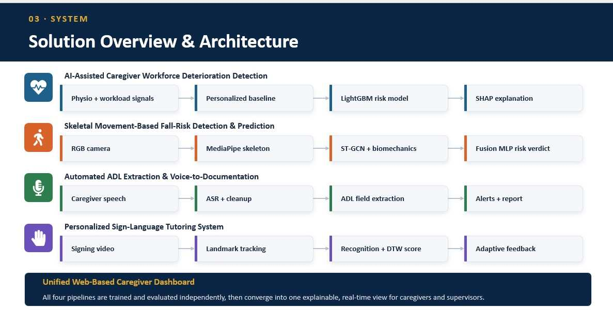
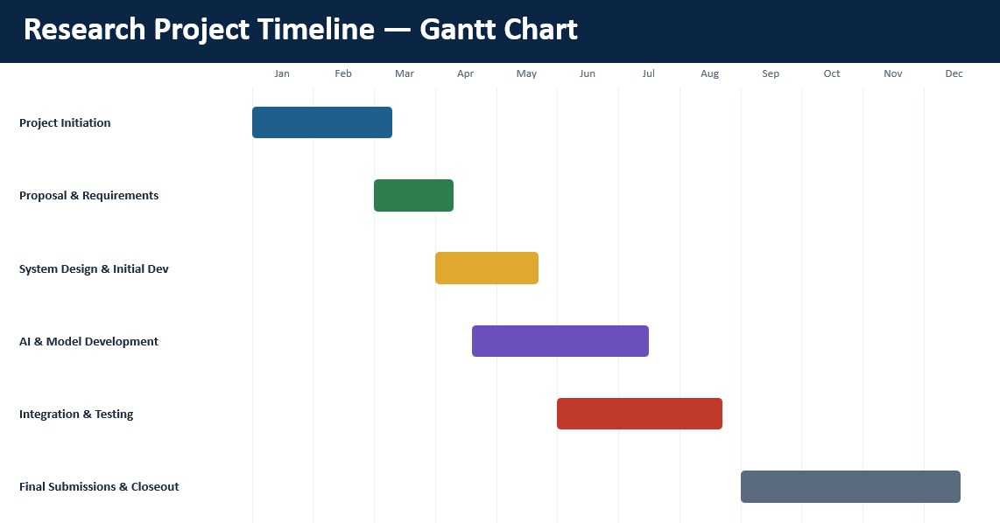
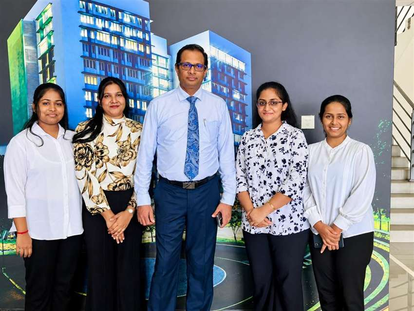

<div align="center">
  

  # CareSense Research Portfolio

  **Multimodal Computational Intelligence for Enhancing Caregiver Performance and Care Delivery**

  SLIIT Faculty of Computing · Data Science · Research Project **R26-DS-010**

  [](index.html)
  [](css/site.css)
  [](js/app.js)
  [](tools/build.ps1)
  [](dist)

  [Explore the source](https://github.com/dayanakumar-IT/R26-DS-010-Intelligent-Care-Support) · [Documents](documents.html) · [Presentations](presentations.html) · [Meet the team](about.html)
</div>

---

## Portfolio preview

<div align="center">
  
</div>

CareSense is an interactive undergraduate research portfolio presenting a shared caregiver-support research framework. It connects four independently evaluated research components without combining their metrics into a single performance claim.

## Research components

| Component | Research focus | Researcher | Representative result |
|---|---|---|---|
| **PULSE** | Caregiver workforce deterioration detection and adaptive workload redistribution | Dayana Priyadharshani Kumar · IT22178640 | Test ROC-AUC **0.7211** |
| **SENTRY** | Edge-enabled skeletal movement analysis for observable fall-risk detection | Harishalinee Elangovan · IT22057488 | Unseen-subject accuracy **97.12%** |
| **SCRIBE** | Automated ADL extraction and real-time documentation from caregiver voice logs | Vidursha Prabagaran · IT22294098 | ASR word error rate **15.57%** |
| **GLOSS** | Personalized sign-language tutoring for caregivers | Kaushalya Nagenthraraja · IT22289384 | Test macro-F1 **0.75** |

> The values above belong to different datasets, tasks, and evaluation protocols. They must not be averaged or interpreted as a combined CareSense system score.

## Shared research context

<div align="center">
  
</div>

The portfolio frames four connected care challenges: occupational strain, patient falls, documentation burden, and accessible communication. Each component has its own problem statement, research gap, objectives, methodology, experiments, results, limitations, and future work.

## System overview

<div align="center">
  
</div>

The system overview shows the four research pipelines converging conceptually into a caregiver-facing dashboard:

1. Physiological and workload signals → personalized baseline → risk model → explainability.
2. RGB video → skeletal landmarks → movement model and biomechanics → fall-risk verdict.
3. Caregiver speech → transcription and cleanup → ADL extraction → alerts and reports.
4. Signing video → landmark tracking → recognition and DTW scoring → adaptive feedback.

## Website sections

| Page | Purpose |
|---|---|
| [Home](index.html) | Project introduction, care context, components, evidence, gallery, team, and supervision |
| [Domain](domain.html) | Literature survey, research gaps, problem, objectives, methodology, and technologies |
| [Milestones](milestones.html) | Interactive project journey and milestone evidence |
| [Documents](documents.html) | Filterable common and per-researcher project documents |
| [Presentations](presentations.html) | Proposal, PP1, and PP2 presentation material |
| [About Us](about.html) | Researcher ownership, contact links, and academic supervision |
| [Contact Us](contact.html) | Project and team contact information |

## Highlights

- Responsive, accessible, buildless HTML/CSS/JavaScript implementation.
- Dark and light appearance modes with saved user preference.
- Animated care-domain backgrounds with reduced-motion support.
- Component-level evidence cards and detailed experiment summaries.
- Person, component, and document-type filters.
- New-tab document viewing for uninterrupted portfolio navigation.
- Interactive milestones, gallery lightbox, and research archive visuals.
- Publication-ready favicon set and mobile web-manifest assets.
- Package-aware build constrained to the course's 20 MiB submission limit.

## Project timeline

<div align="center">
  
</div>

## Technology

### Portfolio

- Semantic HTML5
- Modern responsive CSS
- Vanilla JavaScript
- PowerShell static packaging
- Native browser video, canvas, and local-storage APIs

### Research

`LightGBM` · `SHAP` · `MediaPipe` · `ST-GCN` · `PyTorch` · `Whisper` · `LoRA` · `BART` · `T5` · `TCN` · `SPOTER` · `DTW`

## Run locally

### Requirements

- A modern browser
- PowerShell 5.1 or PowerShell 7+
- Python 3, or another local static-file server

### Build and serve

```powershell
git clone https://github.com/dayanakumar-IT/R26-DS-010-Intelligent-Care-Support.git
cd R26-DS-010-Intelligent-Care-Support
powershell -ExecutionPolicy Bypass -File .\tools\build.ps1
python -m http.server 4173 --directory dist
```

Open <http://localhost:4173>.

Do not open the pages through `file://`. A local server provides reliable navigation, PDF links, videos, and browser security behavior.

## Repository structure

```text
.
├── assets/
│   ├── branding/          # Favicons and web-manifest artwork
│   ├── images/            # Team, fieldwork, diagrams, and gallery media
│   ├── readme/            # Optimized GitHub preview animations
│   └── videos/            # Cinematic website motion assets
├── components/            # PULSE, SENTRY, SCRIBE, and GLOSS pages
├── css/                   # Shared visual system
├── js/                    # Content model and application rendering
├── presentations-assets/  # Web-ready presentation exports
├── publications/          # Research documents and thesis material
├── tools/                 # Static build script
├── dist/                  # Submission-ready generated website
└── *.html                 # Main portfolio entry pages
```

## Source and publication boundaries

- `js/content.js` is the structured source for component descriptions, methods, experiments, results, milestones, documents, and gallery entries.
- `publications/` and `presentations-assets/` contain deliberate publication copies.
- `dist/` is the generated submission package; edit the source files instead of editing `dist/` directly.
- Original high-volume source documents remain outside the web package when required to preserve the 20 MiB course limit.
- Package-optimized exports and approved source links keep project evidence accessible from the portfolio.

## Research accuracy

- Component names and ownership follow the finalized PP2 presentation.
- Implemented methods, results, and limitations follow the revised research paper and individual thesis material.
- Proposal and topic-assessment material is retained as historical context.
- Component results remain separate because their tasks, datasets, and evaluation protocols differ.
- Privacy-preserving gallery copies are used where care-facility photographs include residents.

## Academic guidance

| Role | Name | Affiliation |
|---|---|---|
| Supervisor | Prof. Samantha Thelijjagoda | Senior Professor, Faculty of Computing, SLIIT |
| Co-Supervisor | Mr. Samadhi Rathnayake | Lecturer, Faculty of Computing, SLIIT |
| External Supervisor | Mr. Velu Sivakumar | Senior Carer, United Kingdom |

## Team

<div align="center">
  
</div>

## Documentation notes

- Use the [document library](documents.html) to browse by researcher, component, or document type.
- Document links open in a new browser tab.
- The common thesis and final presentation remain clearly marked until those final artifacts are supplied.
- See [MISSING_CONTENT.md](MISSING_CONTENT.md) for the current outstanding-content register.

---

<div align="center">
  <strong>CareSense · R26-DS-010</strong><br>
  Sri Lanka Institute of Information Technology · Faculty of Computing · Data Science
</div>
